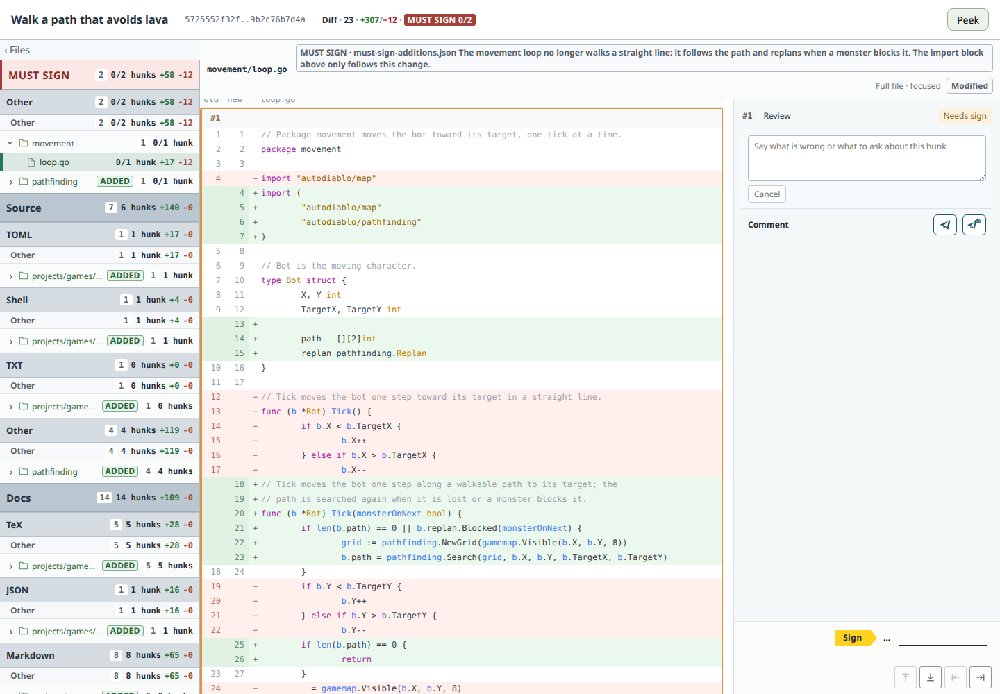
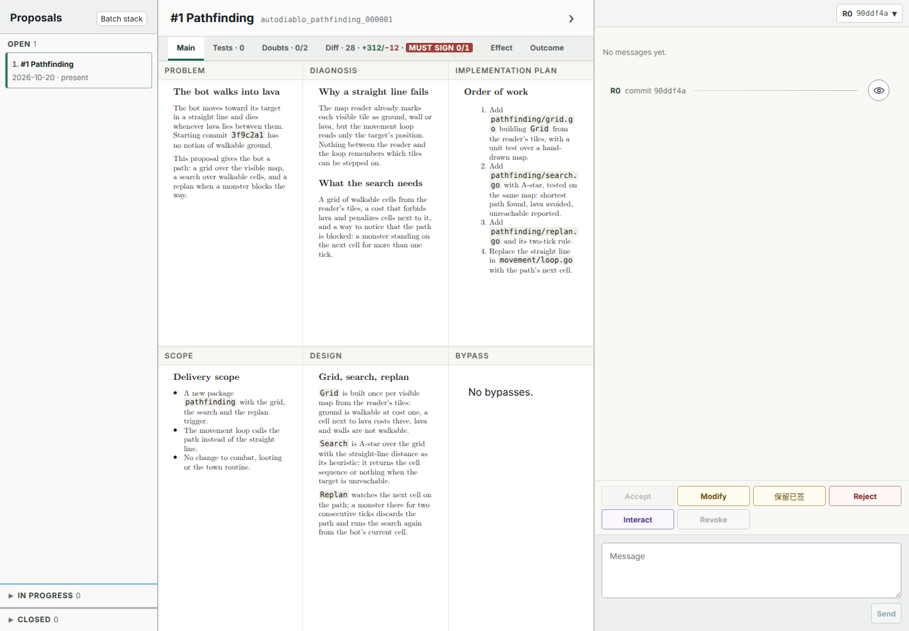
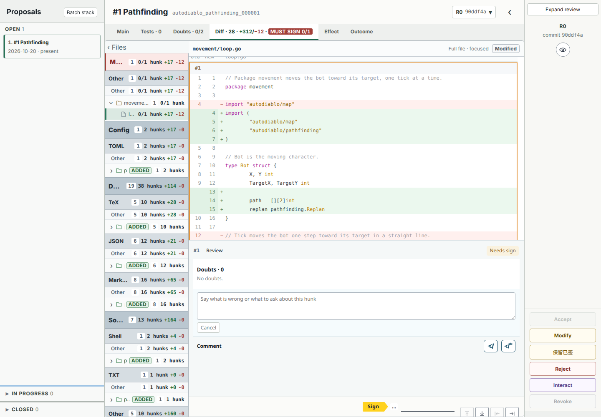
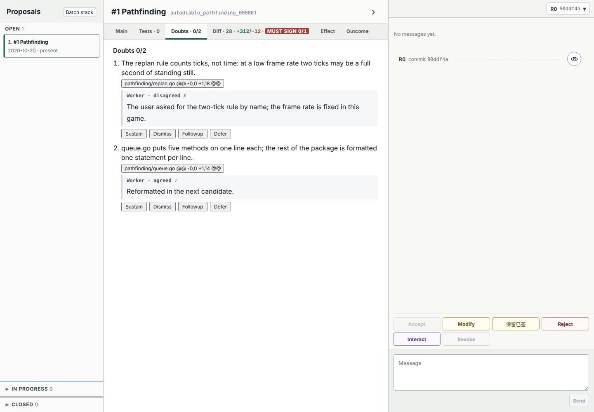

# llm-agent-shared

This repository holds infrastructures for coding with LLM agents:

1. **Correspondence system** — structured web pages for communicating technical material to the user over a remote channel when a chat message is not enough. Read `notes/correspondence/README.md`.
2. **Proposal system** — a multi-role workflow and decision UI that turns a scoped assignment into an independently reviewed, Outcome-measured change ruled on by the user. Read `notes/proposal/README.md`.

Both render their documents through **Kathy**, a lightweight intermediate representation for LaTeX-like documents: a page is written as `.chw.tex`, converted to `.kathy.json`, and rendered in the browser. The Go converter, `go-src/kathy/`, is a skeleton with a TODO; the browser side is complete.

> **Warning:** The code in this repository is entirely generated by AI and has not yet been checked carefully by humans. Treat it as reference material rather than a dependable product.

## Why not plain Claude Code

Used as it comes, a coding agent in a terminal leaves to the user what a terminal does badly.

- **Diffs are hard to view and judge.** A change scrolls past as text; there is no stable place to read a hunk with its full file, mark it as seen, or come back to it. Here a proposal is delivered as a page where every critical hunk is signed one by one, with the criteria that cite the user's own words beside it; the user judges it from a phone, in minutes, whenever convenient.
- **Checks and workflows are hard to enforce.** An instruction in a prompt is followed until it is forgotten. Here the workflow is a program: a candidate passes mechanical gates, the Outcome and three review roles before it reaches the user, and the user's verdict is recorded, not typed into a chat and lost.
- **The UI inside a TUI is limited.** A diagnosis, a set of code pieces to read, a diff to sign: each is a correspondence page built to a fixed guideline, so the same kind of question always has the same shape and is answered in the same place.

## A glance at correspondence

A correspondence class is a directory with the rules of the page and, where the page is not served by a program, the code that builds it:

```text
llm-agent/correspondence/classes/
├── diagnosis/basic/guideline.md     six fixed sections, in order
├── diff/basic/guideline.md          the diff tab as a page
├── diff/advanced/guideline.md       plus MUST SIGN hunks, served by go-src/llm-agent/correspondence/diff-advanced
└── show/code-pieces/                source pieces in reading order; guideline.md and ui/
```

An instance of `diff/advanced` names the repository, the range and the hunks the user must sign:

```json
{"path": "movement/loop.go", "lines": [{"start": 18, "end": 30}],
 "reason": "The movement loop no longer walks a straight line: it follows the path and replans when a monster blocks it."}
```

The page the user opens, with the first MUST SIGN hunk selected and its reason above the file:



## A glance at proposals

A proposal is a directory the Worker writes and the user rules on. The sample `projects/games/autodiablo/proposals/2026/10/20/autodiablo_pathfinding_000001/`:

```text
autodiablo_pathfinding_000001/
├── problem.chw.tex          what is wrong and what the proposal does
├── problem.kathy.json       the same page converted to Kathy, as the browser renders it
├── scope.chw.tex            what is delivered and what is not
├── criteria.md              each criterion cites the user's words
├── design.chw.tex
├── implementation-plan.chw.tex
├── tests.md
├── must-sign-justifications.md
├── evidence/user-rulings.md
├── review.md                the user's verdicts
└── revision.json            base commit, candidate kind, surfaces
```

A criterion in `criteria.md` links to the user's own sentence:

```markdown
- [The bot never steps on lava](evidence/user-rulings.md#L9-L10)
  > Lava cells cost infinity; the search never returns a path through one.
```

The verdict in `review.md`:

```markdown
### 2026-10-20T09:12:40.118Z · Candidate: 8d1e4b7a… · Permission: accept
```

The decision browser on this candidate. The Main tab lays out the proposal's pages, rendered from their Kathy documents, beside the verdict buttons:



The Diff tab, with the MUST SIGN hunk of `movement/loop.go` waiting for a signature:



The Doubts tab, with the Reviewer's and the Nitpicker's items and the Worker's answers:



## Layout

| Path | What it is |
| --- | --- |
| `llm-agent/correspondence/` | The correspondence classes and their entry README. |
| `go-src/llm-agent/correspondence/` | The Go viewer behind `diff/advanced`. |
| `go-src/llm-agent/workflows/` | The proposal programs: `proposal-workflow`, `proposal-decision`, `proposal-platform`. |
| `go-src/kathy/` | The Kathy converter, `.chw.tex` to `.kathy.json`; a skeleton, TODO. |
| `scripts/proposal-tool.sh` | The one entry point to the proposal programs. |
| `webui/` | The browsers of the proposal programs and the packages they are built from. |
| `projects/common/` | The project skeleton every project shares. |
| `projects/<group>/<project>/` | A project; those here are dummies, each with a sample proposal. See `projects/README.md`. |
| `notes/` | The explanation of each infrastructure. |
